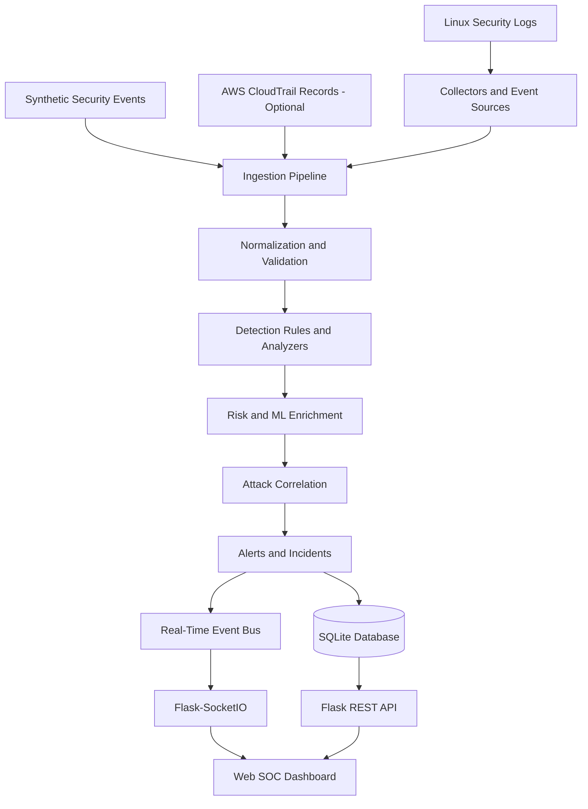

# CloudSentinel
### Cloud-Based Intrusion Detection & Security Monitoring System

CloudSentinel is a Python-based security monitoring and investigation platform that
collects security events, detects suspicious activity, enriches findings with risk
and threat-intelligence context, correlates related events, and presents security
alerts through a web-based SOC dashboard.

The project combines Linux security monitoring with modular event processing,
rule-based detection, incident investigation, local anomaly detection, and optional
AWS CloudTrail event ingestion.

> **Project status:** Active development and local testing. Public production
> readiness, authentication, and live AWS deployment must be evaluated separately
> before exposing the service to untrusted networks.

## Key Features

- **Security event ingestion:** Normalize and validate security events from supported
  input sources.
- **Threat detection:** Detect authentication failures, brute-force patterns, and
  other configured suspicious activity.
- **Rule-based detection:** Manage detection logic through YAML configuration.
- **Risk analysis:** Calculate risk information and classify security findings.
- **Attack correlation:** Relate events using attributes such as source IP, user
  identity, event relationships, and time windows.
- **Incident investigation:** Retrieve incidents, review timelines, inspect
  investigation context, and manage incident status and history.
- **Threat intelligence:** Enrich events with available threat-intelligence data
  and indicator context.
- **MITRE ATT&CK mapping:** Associate supported detection rules and events with
  relevant ATT&CK mappings.
- **Local ML anomaly detection:** Extract event features and identify potentially
  unusual security activity.
- **Real-time alert feed:** Deliver security-event updates to connected dashboard
  clients through Flask-SocketIO.
- **Threat hunting:** Search security data and manage saved hunting queries and
  investigations.
- **Persistent storage:** Store security data using SQLite.
- **Optional AWS CloudTrail integration:** Normalize CloudTrail records and replay
  or ingest events through a supplied client.
- **Security reporting and notifications:** Generate reports and support alert
  notification workflows.

## Architecture



The event-processing design separates ingestion, normalization, validation,
detection, risk analysis, correlation, and alert presentation into modular
components. The background worker currently uses an in-memory queue; it is not
a distributed or durable message broker.

## Technology Stack

| Area | Technologies |
|---|---|
| Language | Python |
| API and web application | Flask |
| Real-time communication | Flask-SocketIO, Socket.IO |
| Data storage | SQLite |
| Detection configuration | YAML, PyYAML |
| Anomaly detection | Local Python-based ML analysis |
| Security analysis | Risk scoring, event correlation, threat intelligence |
| Attack framework | MITRE ATT&CK mapping |
| Cloud telemetry | Optional AWS CloudTrail client integration |
| Frontend | HTML, CSS, JavaScript |
| Testing | pytest |
| WSGI server option | Gunicorn with threaded workers |
| Version control | Git and GitHub |

## Repository Structure

```text
CloudSentinel/
├── config/
│   └── rules/
│       └── detection_rules.yaml
├── docs/
│   ├── event_pipeline.md
│   └── worker_architecture.md
├── reports/
├── src/
│   ├── ai/
│   ├── alerts/
│   ├── analyzers/
│   ├── api/
│   ├── collectors/
│   ├── data/
│   ├── hunting/
│   ├── ingestion/
│   ├── mitre/
│   ├── models/
│   ├── realtime/
│   ├── rules/
│   ├── threat_intel/
│   ├── agent.py
│   └── ...
├── templates/
│   └── dashboard.html
├── tests/
│   └── data/
│       └── sample_auth.log
├── .env.example
├── .gitignore
├── pytest.ini
├── requirements.txt
└── requirements-dev.txt
```

The tree highlights major components; additional modules and tests are present
throughout `src/`.

## Prerequisites

- Linux or Ubuntu is recommended for local security-log testing.
- Python version compatible with the dependencies in `requirements.txt`.
- Git.
- Optional: Node.js/npm if you need to manage the existing Socket.IO client
  dependency.
- Optional: threat-intelligence credentials or an AWS client for integrations
  that require them.

## Installation

Clone the repository and enter the project directory:

```bash
git clone https://github.com/Krishangiverma/CloudSentinel.git
cd CloudSentinel
```

Create and activate a virtual environment:

```bash
python3 -m venv .venv
source .venv/bin/activate
```

Install the development dependencies:

```bash
python -m pip install --upgrade pip
python -m pip install -r requirements-dev.txt
```

Check installed dependency consistency:

```bash
python -m pip check
```

## Configuration

The `.env.example` file documents optional integration settings and required dashboard authentication variables. The application reads authentication settings from its process environment; creating a `.env` file alone does not automatically load those variables.

Required authentication settings:

- `CLOUDSENTINEL_USERNAME`: dashboard login username.
- `CLOUDSENTINEL_PASSWORD_HASH`: Werkzeug password hash, never a plaintext password.
- `CLOUDSENTINEL_SECRET_KEY`: randomly generated Flask session signing key of at least 32 characters.
- `CLOUDSENTINEL_COOKIE_SECURE`: set to `true` for HTTPS deployments; use `false` only for local HTTP testing.
- `CLOUDSENTINEL_CSRF_ENABLED`: optional application setting; CSRF validation is enabled by default.

Generate a password hash interactively:

```bash
.venv/bin/python -c 'from getpass import getpass; from werkzeug.security import generate_password_hash; print(generate_password_hash(getpass("Dashboard password: ")))'
```

Generate a session signing key:

```bash
.venv/bin/python -c 'import secrets; print(secrets.token_urlsafe(48))'
```

Set the username, generated password hash, and signing key as environment variables before starting the application. Never commit real credentials, generated keys, API tokens, or `.env` files.

`OTX_API_KEY` is optional for the relevant threat-intelligence integration. Review the integration code before relying on optional environment variables.


## Run Locally

From the project root, with the virtual environment activated:

```bash
python -m src.api.app
```

The development server is configured to listen on port `5000`.

Open the dashboard:

```text
http://127.0.0.1:5000/dashboard
```

Check API health:

```bash
curl http://127.0.0.1:5000/api/health
```

The health endpoint reports the API service status. It should not be interpreted
as a complete readiness check for every database, integration, or background
component.

### Optional threaded WSGI launch

A Gunicorn configuration check has been performed with a single `gthread` worker.
For a local deployment experiment, use:

```bash
python -m gunicorn \
  --worker-class gthread \
  --workers 1 \
  --threads 20 \
  --bind 0.0.0.0:5000 \
  src.api.app:app
```

This is a deployment starting point, not a claim of hardened production readiness.
The application uses Flask-SocketIO with threading mode and in-process event-bus
state, so do not increase the worker count without reviewing shared state and
real-time event delivery. For a public deployment, configure a reverse proxy and
TLS, restrict network access, add appropriate authentication and authorization,
and verify WebSocket behavior in the target environment.

## API Reference

The following routes are implemented in the application. Individual endpoints may
require specific request bodies, parameters, or existing records.

| Method | Endpoint | Purpose |
|---|---|---|
| GET | `/` | API home |
| GET | `/api` | API information |
| GET | `/api/health` | Service health response |
| GET | `/dashboard` | Security monitoring dashboard |
| GET | `/api/events` | Retrieve security events |
| POST | `/api/events` | Submit a security event |
| GET | `/api/stats` | Event statistics and risk analysis |
| GET | `/api/incidents` | Retrieve correlated incidents |
| GET | `/api/incidents/<incident_id>` | Retrieve an incident |
| PATCH | `/api/incidents/<incident_id>/status` | Update incident status |
| GET | `/api/incidents/<incident_id>/history` | Retrieve incident status history |
| GET | `/api/incidents/<incident_id>/investigation` | Retrieve investigation details |
| GET | `/api/incidents/<incident_id>/report` | Retrieve an incident report |
| GET | `/api/incidents/<incident_id>/context` | Retrieve investigation context |
| POST | `/api/hunts/search` | Search security data |
| GET, POST | `/api/hunts/saved` | List or save hunting queries |
| GET, DELETE | `/api/hunts/saved/<query_id>` | Retrieve or delete a saved query |
| GET, POST | `/api/hunts/investigations` | List or create investigations |
| GET | `/api/hunts/investigations/<investigation_id>` | Retrieve an investigation |
| GET | `/api/hunts/investigations/<investigation_id>/timeline` | Retrieve an investigation timeline |
| POST | `/api/hunts/investigations/<investigation_id>/promote` | Promote a hunting finding |
| GET | `/api/mitre/mappings` | Retrieve MITRE mappings |
| GET | `/api/mitre/mappings/<rule_id>` | Retrieve a mapping for a rule |

Example requests:

```bash
curl http://127.0.0.1:5000/api
curl http://127.0.0.1:5000/api/events
curl http://127.0.0.1:5000/api/stats
curl http://127.0.0.1:5000/api/incidents
curl http://127.0.0.1:5000/api/mitre/mappings
```

For write operations, inspect the relevant route implementation and tests for
the expected JSON schema and validation behavior.

## Testing

Run the complete pytest suite from the repository root:

```bash
python -m pytest -q
```

Run a focused test module:

```bash
python -m pytest -q src/test_attack_correlator.py
python -m pytest -q src/test_aws_cloudtrail_day117.py
python -m pytest -q src/test_local_ml_anomaly_day110.py
```

Check patch whitespace before committing:

```bash
git diff --check
```

Test results depend on the current code and environment. Run the suite locally
before using a test count or pass rate in a release description.

## AWS CloudTrail Integration

CloudSentinel includes optional code for normalizing CloudTrail records and
processing records through a supplied client. The integration supports pagination
and validates input parameters, with tests using a mocked client.

The implementation does not by itself provision AWS resources or configure an
AWS account. Live use requires an appropriately configured AWS client, credentials,
region, permissions, and validation in a controlled environment. Follow least
privilege and review AWS charges before enabling any billable services.

## Data and Security Considerations

- SQLite data and runtime logs may contain sensitive security information.
- Keep credentials and API keys out of source control.
- Use synthetic data for public demonstrations whenever possible.
- Do not expose the development server or unauthenticated API to the public
  internet.
- Review and restrict endpoints that create events, change incident status,
  manage hunting data, or expose investigation context.
- Apply authentication, authorization, input validation, logging, TLS, and
  deployment-specific hardening before handling real production telemetry.
- The in-memory worker queue is not durable across process restarts.
- Review data retention and backup requirements before using the system for
  operational security monitoring.

## Current Limitations

CloudSentinel is an evolving security engineering project. The following areas
require environment-specific review before production use:

- Authentication and role-based access control.
- Public deployment hardening and TLS/reverse-proxy configuration.
- Live AWS CloudTrail integration and permissions validation.
- Persistence and recovery for queued background work.
- Multi-process or multi-instance real-time event delivery.
- Operational monitoring, retention, and backup policies.
- End-to-end validation against representative production telemetry.

## Documentation

- [Event Processing Pipeline](docs/event_pipeline.md)
- [Background Worker Architecture](docs/worker_architecture.md)

## Author and Project

**CloudSentinel** — Cloud-Based Intrusion Detection & Security Monitoring System

GitHub repository: https://github.com/Krishangiverma/CloudSentinel

Built as a hands-on security engineering project exploring event ingestion,
detection, risk analysis, incident correlation, threat intelligence, and SOC-style
monitoring.
